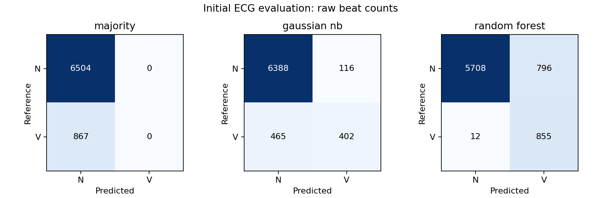

# Method and Baseline

Sowmya | Remote Patient Health Monitoring Using Machine Learning

Sowmya | Step 2, Week 2 | November 3, 2026

Remote Patient Health Monitoring Using Machine Learning: an offline ECG classification study. This milestone demonstrates an evidence-producing computational process, not a completed research investigation.

## 1. Computational method implemented

My research question is: How do Gaussian Naive Bayes and Random Forest compare in classifying selected MIT-BIH ECG heartbeat classes under a subject-disjoint evaluation design? My working hypothesis remains nondirectional: the classifiers may differ in macro-F1 and class-specific precision and recall.

I implemented an initial binary comparison using original annotation symbols N (normal beat) and V (premature ventricular contraction). These are not full AAMI superclasses. All other symbols are excluded as prediction targets. Expert annotations provide beat locations and the previous reference-beat interval; automatic beat detection is outside this experiment.

I select MLII by name and require 360 Hz. A beat window contains 90 samples before the annotation and 126 samples from the annotation onward, with the upper endpoint excluded: 216 samples or 0.6 seconds. I exclude absent preceding beats, incomplete windows and nonfinite or constant windows. No filtering, imputation or oversampling is applied.

My 27 features contain the previous reference-beat interval in seconds, raw window standard deviation and peak-to-peak amplitude, and 24 linearly interpolated values from a per-window z-normalized waveform. Previous timing uses all recognized reference beat types, not rhythm/noise annotations; excluded target types can still delimit an interval. Feature extraction does not receive the target label.

## 2. Source code responsible for the method

src/week1_ecg_research_foundation.ipynb preserves my original Week 1 cells and appends Week 2 setup, acquisition, segmentation/features, validation, model comparison, evidence/repeatability, and observations. The complete Week 2 code is also in src/run_week2_ecg.py. src/week2_protocol.json fixes the partitions, targets, features, settings and metrics before scoring. src/requirements_week2.txt records the tested packages. src/build_week2_report.py renders this report from generated results.

## 3. Baseline and reference conditions

A DummyClassifier using the most frequent training class is the simple reference. Gaussian Naive Bayes and Random Forest use the same training and evaluation rows and features. Each learned-model pipeline fits StandardScaler on training data only. This avoids fitting a population transform to evaluation features; per-window z-normalization is a fixed operation within each individual waveform.

## 4. Experimental procedure and fixed parameters

I selected a small convenience subset expanding the Week 1 foundation. Training records are 106, 108 and 119; evaluation records are 100, 105 and 200. These six records are from different subjects. Records 201 and 202 share a subject and are excluded; my grouping helper also assigns them a common group defensively. I do not randomly split beats or claim to implement the full standard inter-patient benchmark.

The versioned PhysioNet source is MIT-BIH Arrhythmia Database 1.0.0. For each record I acquire .hea, .dat and .atr files, record local SHA-256 hashes, and verify signal/annotation structure. The hashes record the acquired bytes; they have not been independently verified against provider checksums. Raw files are excluded from Git and can be downloaded by the code.

| Partition | Record | N beats | V beats |
| --- | --- | --- | --- |
| Train | 106 | 1506 | 520 |
| Train | 108 | 1738 | 17 |
| Train | 119 | 1542 | 444 |
| Evaluation | 100 | 2237 | 1 |
| Evaluation | 105 | 2525 | 41 |
| Evaluation | 200 | 1742 | 825 |

The resulting feature table contains 5,767 training beats and 7,371 evaluation beats. Eight N/V annotations were excluded: six lacking a preceding reference beat and two with incomplete windows. All other annotation types are counted separately and excluded as targets rather than relabeled N.

GaussianNB uses var_smoothing=1e-9. RandomForestClassifier uses 100 trees, max_depth=12, min_samples_leaf=2, class_weight=balanced, random_state=42 and n_jobs=1. These settings and the partition were fixed before scoring. There is no hyperparameter search, cross-validation or resampling. Record 100 was inspected descriptively in Week 1, so I do not treat this development evaluation as an untouched final holdout.

Primary evidence is pooled macro-F1 over fixed labels [N,V], plus each class precision, recall, F1 and support. I also record accuracy, balanced accuracy, confusion matrices and per-record macro-F1. Undefined precision/recall is set to zero. Pooled metrics weight beats equally; they do not give each subject equal weight. Per-record results retain both labels in macro-F1 regardless of support.

## 5. Execute and reproduce the experiment

Use a dedicated Python environment. From the repository root run: python -m pip install -r src/requirements_week2.txt ; then python src/run_week2_ecg.py . The commands are separate steps. Alternatively open the notebook from the repository root or src folder and run its Week 2 section in order. Initial downloads require internet and about 12 MB. Cached nonempty raw files are reused.

The standalone script runs Week 2 without overwriting Week 1 artifacts. A full notebook rerun includes the original Week 1 cells, which recreate their outputs and environment files as documented there; skip the optional Week 1 installation cell when dependencies are configured. Run python src/build_week2_report.py after results exist to regenerate this report.

## 6. Initial experimental results

| Method | Accuracy | Balanced acc. | Macro-F1 |
| --- | --- | --- | --- |
| majority | 0.882377 | 0.500000 | 0.468757 |
| gaussian nb | 0.921178 | 0.722916 | 0.768504 |
| random forest | 0.890381 | 0.931886 | 0.806505 |

On this fixed partition, Random Forest macro-F1 exceeded Gaussian Naive Bayes by 0.038002. Gaussian Naive Bayes had higher accuracy. The majority reference achieved 88.24% accuracy while detecting no V beats, demonstrating the limitation of accuracy alone for this imbalanced evaluation.

| Method | V precision | V recall | V F1 |
| --- | --- | --- | --- |
| majority | 0.000000 | 0.000000 | 0.000000 |
| gaussian nb | 0.776062 | 0.463668 | 0.580505 |
| random forest | 0.517868 | 0.986159 | 0.679110 |

Gaussian Naive Bayes correctly identified 402 of 867 V beats, missed 465, and incorrectly labeled 116 N beats as V. Random Forest identified 855 V beats, missed 12, and incorrectly labeled 796 N beats as V. Random Forest therefore improved V recall at a substantial false-positive cost. Its balanced class weights are part of the configuration, so this does not isolate architecture alone.

The result was not consistent across all subjects. GaussianNB / Random Forest macro-F1 was 1.000000 / 0.833222 on record 100, 0.601660 / 0.537161 on record 105, and 0.753942 / 0.840734 on record 200. Record 100 has only one V beat. Record 200 contributes 825 of the 867 evaluation V beats, so pooled minority-class results depend heavily on that subject.

metrics_summary.csv, metrics_by_class.csv, metrics_by_record.csv and confusion_matrices.csv hold the computed values. predictions.npz stores every evaluation record ID, annotation sample, true label and model prediction. Load it with numpy.load(..., allow_pickle=False); all arrays have the same row order. No synthetic examples or invented classifier scores were used.

## 7. Validation checks performed

All 30 automated checks passed. Pre-fit checks cover known feature length, previous interval, analytic standard deviation, peak-to-peak amplitude and morphology endpoints; invalid/constant/nonfinite window and interval rejection; same-subject 201/202 grouping; record/subject separation; unique record/sample keys; finite features; both classes in each partition; exclusion accounting; and known macro-F1/confusion-matrix examples.

Post-fit checks verify valid predictions and confusion totals for all three methods, training-only scaler statistics and fit counts for both learned models, unchanged protocol bytes, and identical Random Forest predictions after a same-seed refit. The refit checks repeatability, not statistical uncertainty. Validation results are recorded in validation_checks.csv. Checks do not independently establish annotation accuracy or physiological quality.

## 8. Methodological problems and unresolved questions

Only three training and three evaluation subjects are included. Within-subject beats are correlated, and the V class is concentrated in one evaluation subject. Neither the large beat count nor a same-seed refit establishes population-level generalization or statistical superiority. Full-database, independent and external validation remain unperformed.

Only original N and V symbols are modeled; other beat categories, paced beats and artifacts are not classified. Reference annotations provide both center locations and timing. The post-beat window and oracle timing prevent treating this as a real-time detector or monitoring system. No clinical diagnosis, alarm behavior or heart-attack prediction is evaluated.

My next priorities are to add subjects with meaningful V support, examine record-level false positives and misses, define a validation partition before changing parameters or features, and assess subject-level variability when the number of subjects permits. These are planned Week 3 tasks. The present evidence demonstrates a functioning method with preliminary differences and trade-offs rather than a final winning classifier.

## Execution provenance and references

Executed Python 3.12.14; numpy 2.3.5, pandas 2.2.3, scipy 1.17.0, matplotlib 3.10.8, wfdb 4.3.1, scikit-learn 1.8.0. execution_summary.json records the protocol, hashes, feature names, timing and environment. Timing is descriptive and environment-dependent. The saved Week 2 execution is from the recorded preparation environment; exact bitwise reproduction across systems is not guaranteed.

Moody, G., & Mark, R. (2005). MIT-BIH Arrhythmia Database (v1.0.0). PhysioNet. https://doi.org/10.13026/C2F305 . Database description: https://physionet.org/content/mitdb/1.0.0/ . Annotation definitions: https://physionet.org/physiobank/database/html/mitdbdir/intro.htm . WFDB reading API: https://wfdb.readthedocs.io/en/latest/io.html . scikit-learn model documentation: https://scikit-learn.org/stable/modules/naive_bayes.html and https://scikit-learn.org/stable/modules/ensemble.html#forest .
